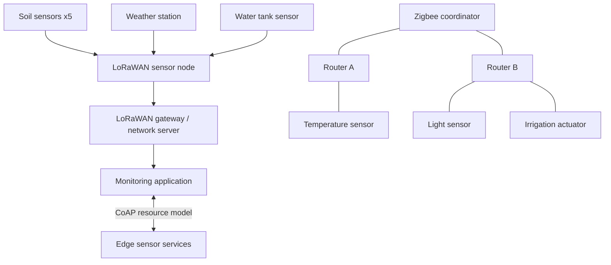

# System architecture — Practical Work 3.2

## Goal
Model an agricultural monitoring system using three communication layers.

## Architecture

## Protocol comparison

| Technology | Role | Strength | Limitation |
|---|---|---|---|
| LoRaWAN | Long-range uplinks | Low power, wide coverage | Small payloads, limited downlink |
| Zigbee | Local mesh | Multi-hop routing | Shorter range, needs powered routers |
| CoAP | Application messaging | Lightweight REST-style resources | Requires an IP transport/network |

## Energy estimate

Assume a hypothetical node sleeps for 98% of each hour:
- Sleep: 58.8 minutes per hour.
- Active: 1.2 minutes per hour.
- This is a design target, not a measured result.

Actual battery life depends on radio current, sensor current, battery capacity,
transmission interval, spreading factor, and environmental conditions.

## Validation boundaries

The Python project tests binary payload handling, route lookup, simulated
router failure/rejoin, and local CoAP resource operations.

It does not demonstrate actual LoRa radio range, TTN OTAA, Zigbee radio
encryption, RF mesh self-healing, or measured energy consumption.
These require hardware and appropriate network infrastructure.
